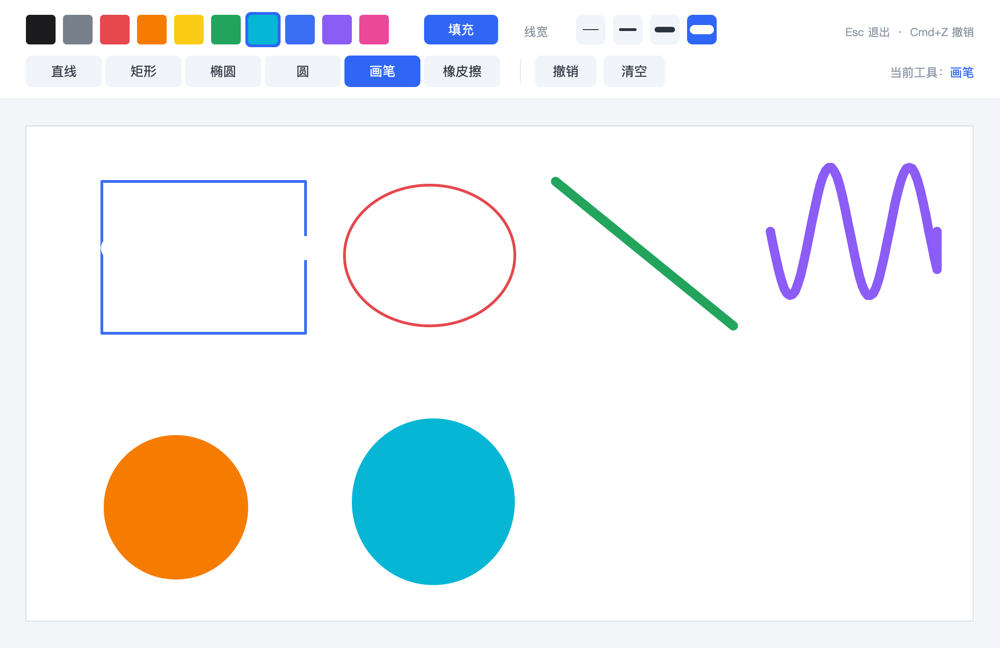

# EasyX 简易画板（macOS + CLion）



## 一、这是什么

一个用 EasyX 接口写的画板作业。

EasyX 官方的库是 Windows 的，macOS 上不能直接安装。项目在 `compat/` 里实现了
与 EasyX 同名、同参数的 `graphics.h`，内部用 macOS 自带的 Cocoa + CoreGraphics
绘图、开窗口、接收鼠标键盘消息。因此：

* 不需要安装 EasyX；
* 用 CLion 打开项目即可编译、运行、调试；
* 本项目只面向 macOS，不包含 Windows 构建。

## 二、功能

| 功能 | 说明 |
| --- | --- |
| 颜色选择 | 黑、灰、红、橙、黄、绿、青、蓝、紫、粉，共 10 种 |
| 形状选择 | 直线、矩形、椭圆、圆 |
| 画笔 | 自由手绘 |
| 橡皮擦 | 按住左键擦除，粗细随线宽变化 |
| 画图区 | 独立白色画布，笔画不会画到画布外 |
| 填充 | 矩形 / 椭圆 / 圆可以切换实心或空心 |
| 线宽 | 1 / 3 / 6 / 10 四档 |
| 实时预览 | 拖动过程中就能看到形状，松开鼠标才落笔 |
| 撤销 / 清空 | 工具栏按钮，或 Cmd+Z / Ctrl+Z |
| 状态提示 | 右下角显示当前工具，空画布有操作提示 |

快捷键：`Esc` 退出，`Cmd+Z`（或 `Ctrl+Z`）撤销。

## 三、用 CLion 运行

1. 打开 CLion，选择 **File → Open**，打开本项目文件夹 `homework`。
2. 如果弹出 “Trust project”，选择 **Trust Project**。
3. 等待 CMake 配置完成（第一次大约十几秒）。
   如果没自动开始：右键 `CMakeLists.txt` → **Reload CMake Project**。
4. 右上角运行配置选择 **paint**，点击绿色三角运行（或 `Ctrl+R`）。
5. 弹出 1080×700 的画板窗口即可开始画图。

> 如果运行配置里没有 `paint`：
> **Run → Edit Configurations → + → CMake Application**，
> Target 选择 `paint`，即可运行。

命令行方式（可选）：

```bash
cmake -S . -B build
cmake --build build -j
./build/paint
```

环境要求：macOS（Intel / Apple Silicon 均可）、Xcode Command Line Tools
（终端执行 `xcode-select --install` 安装）、CMake 3.20+。
CLion 自带的 CMake 就够用。

## 四、操作说明

1. 在顶部第一排点一个颜色；
2. 在第二排点一个工具（直线 / 矩形 / 椭圆 / 圆 / 画笔 / 橡皮擦）；
3. 在下方白色画布上**按住鼠标左键拖动**：
   * 直线、矩形、椭圆：从起点拖到终点；
   * 圆：按下的位置是圆心，拖动距离是半径；
   * 画笔、橡皮擦：按住拖动即可连续绘制 / 擦除；
4. 松开左键完成绘制；
5. 画错了点“撤销”，想重来点“清空”。

“填充”按钮控制矩形 / 椭圆 / 圆是实心还是空心；
线宽按钮同时决定画笔的粗细，橡皮擦的粗细会跟着线宽变化。

## 五、项目结构

```
homework/
├── CMakeLists.txt              # macOS 构建脚本
├── src/
│   └── main.cpp                # 画板界面 + 绘图逻辑（只使用 EasyX 接口）
├── compat/
│   ├── include/
│   │   └── graphics.h          # EasyX 兼容层头文件
│   └── src/
│       └── easyx_mac.mm        # 兼容层实现：Cocoa 窗口 + CoreGraphics 绘图
├── docs/
│   └── preview.png             # 界面预览图
└── README.md
```

`src/main.cpp` 里的主要结构：

* `ui` / `col`：界面尺寸与配色常量；
* `kPalette` / `kWidths` / `kToolNames`：调色板、线宽、工具名称；
* `Rect` / `Stroke`：按钮区域、一条笔画的数据结构；
* `PaintBoard`：布局、鼠标 / 键盘消息、绘制、撤销、清空等全部逻辑；
* `render()`：每次状态变化后重绘画布和工具栏。

## 六、兼容层说明

### 已实现

* 窗口：`initgraph` / `closegraph` / `getwidth` / `getheight`
* 颜色：`setbkcolor` / `setlinecolor` / `setfillcolor` / `settextcolor`
* 图形：`line` / `rectangle` / `fillrectangle` / `roundrect` / `fillroundrect`
  / `ellipse` / `fillellipse` / `circle` / `fillcircle` / `polyline` / `polygon` / `fillpolygon`
* 文字：`settextstyle` / `outtextxy` / `textwidth` / `textheight` / `setbkmode`
* 线型：`setlinestyle(PS_SOLID, 粗细)`
* 消息：`peekmessage` / `ExMessage`（鼠标、键盘）
* 双缓冲：`BeginBatchDraw` / `FlushBatchDraw` / `EndBatchDraw`
* 其他：`Sleep`

### 未实现

`IMAGE` 图片对象、图片读写、裁剪区域、旋转文字、鼠标滚轮等。
这些接口本作业用不到；需要时可以参考 `easyx_mac.mm` 继续补。

### 原理

1. 所有绘图函数都画进一块内存位图，由 CoreGraphics 负责画线和中文文字；
2. 画完一帧把位图转成 `NSImage` 显示到窗口上；
3. Cocoa 的鼠标 / 键盘事件被转换成 EasyX 的 `WM_LBUTTONDOWN`、`WM_MOUSEMOVE`
   等消息，由 `peekmessage` 交给画板代码。

### 调试截图模式

```bash
./build/paint --shot docs/preview.png
```

不开窗口，直接把示例画面渲染成 PNG，方便检查界面布局。

## 七、常见问题

**Q：CLion 报 “CMake Error: No CMAKE_OBJCXX_COMPILER could be found.”**
安装 Xcode Command Line Tools：`xcode-select --install`，然后在 CLion 里
**Tools → CMake → Reset Cache and Reload Project**。

**Q：运行后只有 Dock 图标，没有窗口？**
程序必须在当前 macOS 桌面会话里运行（CLion 直接运行即可）。
通过 SSH 远程运行是看不到窗口的。

**Q：中文显示成方块？**
macOS 上使用系统字体 `PingFang SC`，正常不会缺字。
如果修改过字体名，改回 `PingFang SC` 即可。

## 八、说明

这套兼容层是为了在 Mac 上完成 EasyX 画板作业而写的，接口尽量贴近 EasyX；
它不能 100% 替代 EasyX（例如没有 `IMAGE`、`saveimage`），但覆盖了画板所需的全部功能。
